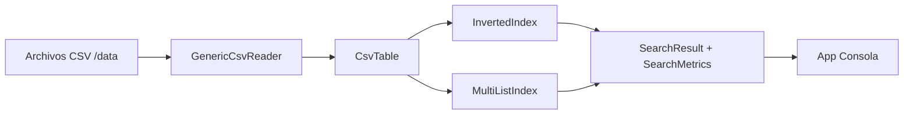

# Semana 09 - Sesión 02: Listas Invertidas y Multilistas

## Propósito didáctico
Este proyecto permite ejecutar casos prácticos de búsqueda externa en archivos CSV usando dos estructuras:

- **Lista invertida:** permite ubicar rápidamente todos los registros asociados a un valor de atributo.
- **Multilista:** permite que un mismo registro participe en varias cadenas enlazadas por diferentes atributos.

## Arquitectura del proyecto



## Componentes

| Componente | Responsabilidad |
|---|---|
| `GenericCsvReader` | Lee cualquier CSV con cabecera y genera una tabla genérica. |
| `CsvTable` | Guarda columnas y registros. |
| `CsvRecord` | Representa una fila como mapa `columna -> valor`. |
| `InvertedIndex` | Construye listas invertidas por columnas seleccionadas. |
| `MultiListIndex` | Construye cadenas enlazadas por atributo y valor. |
| `SearchMetrics` | Registra resultados, comparaciones, nodos visitados y tiempo. |
| `App` | Menú de consola para cargar CSV, construir índices y buscar. |

## Casos incluidos

| Caso | Archivo | Uso sugerido |
|---|---|---|
| 01 | `caso01_inventario_ti.csv` | Caso guiado por el docente. Buscar por marca, categoría y estado. |
| 02 | `caso02_biblioteca_digital.csv` | Buscar libros por autor, categoría o sede. |
| 03 | `caso03_tickets_ti.csv` | Buscar tickets por servicio, prioridad o estado. |
| 04 | `caso04_ventas_retail.csv` | Buscar ventas por marca, región o canal. |
| 05 | `caso05_clinica_atenciones.csv` | Buscar atenciones por especialidad, médico o turno. |
| 06 | `caso06_logistica_almacen.csv` | Buscar movimientos por almacén, zona o proveedor. |

Cada archivo contiene **1000 registros**.

## Cómo ejecutar

```bash
mvn clean compile
mvn exec:java
```

Ejemplo de ruta para cargar el caso guiado:

```text
data/caso01_inventario_ti.csv
```

## Ejecución sugerida del caso guiado

1. Cargar `data/caso01_inventario_ti.csv`.
2. Mostrar los 10 primeros registros.
3. Construir lista invertida con columnas: `marca,categoria,estado`.
4. Buscar con lista invertida: `marca = HP`.
5. Construir multilista con columnas: `marca,categoria,estado`.
6. Buscar con multilista: `categoria = Laptop`.
7. Comparar métricas: resultados, comparaciones, nodos visitados y tiempo.

## Idea clave para explicar en clase

La **lista invertida** agrupa registros por valor de atributo. Es directa para búsquedas por igualdad.

La **multilista** mantiene enlaces entre registros que comparten un mismo valor de atributo. El mismo registro puede estar enlazado en varias cadenas al mismo tiempo.
